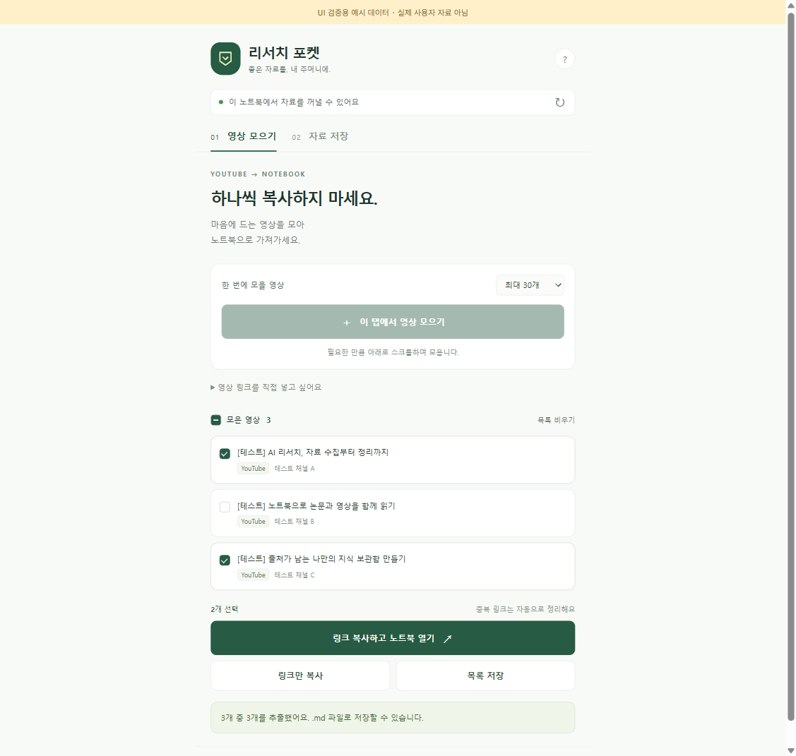
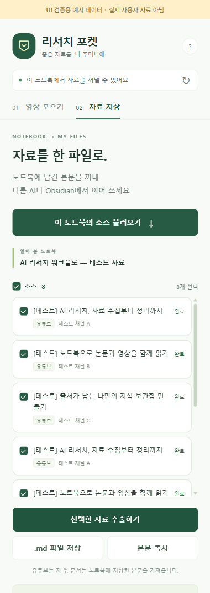

English | [한국어](README.md)

# Research Pocket (리서치 포켓)

**Collect YouTube videos in one go, and export your notebook sources as a single file — all from a browser side panel.**

To add YouTube videos as sources in NotebookLM (Gemini Notebook), you normally copy and paste each link one at a time. And once your sources pile up in a notebook, there's no easy way to export their text as one file for another AI chat or for Obsidian. Research Pocket handles both jobs from a single side panel in Chrome or Edge.

No API key, no server, nothing extra to install. Load the extension folder and it's ready to use.

> **Note:** The extension's interface is in Korean only. This guide quotes each button label in Korean, followed by an English translation in parentheses.

## Features

### Collect videos (영상 모으기)

- Collects videos from YouTube search results, a channel's Videos tab, playlists, and regular video pages. List pages are scrolled automatically while collecting. Shorts are skipped.
- Pick the videos you want and click **링크 복사하고 노트북 열기** (Copy links and open notebook) — the links are copied and your notebook opens.
- You can also paste video links in by hand.
- Search your collected videos by title, channel, or URL.
- Delete selected videos, and undo a deletion within 5 minutes.
- Open as many panels as you like — they all share the same list. Adding, selecting, or deleting in one panel shows up in the others.
- The list holds up to 500 videos.

### Save sources (자료 저장)

- Choose one of the notebooks open in the current window and load its sources.
- Extract the text of the sources you select, then save it as a `.md` file or copy it to the clipboard.
- If only some sources came through, retry just the ones that failed or didn't finish.
- If a refresh fails, the text you already had is kept, and both the screen and the file note that it's the earlier text and when it was extracted.
- Items that couldn't be retrieved are listed separately as missing. You can save a report of the missing items even if no text was extracted.
- If you hit a request limit, the remaining extractions stop and the panel tells you when you can try again.

## Screenshots

| Collect videos | Save sources |
| --- | --- |
|  |  |
| Sample data | Sample data |

## Installation

Research Pocket is not on the Chrome Web Store. You install it yourself in developer mode, and **it does not update automatically.**

**Requirements**: desktop Chrome 116 or later, or Chromium-based Edge

### Install from a release (recommended)

1. Download `research-pocket-1.1.0.zip` from [Releases](https://github.com/Hanriverflow/notebookLM-research-helper/releases/latest) and unzip it.
2. Type `chrome://extensions` in the address bar. In Edge, use `edge://extensions`.
3. Turn on **Developer mode**.
4. Click **Load unpacked**.
5. Select the **`research-pocket/extension`** folder inside the unzipped folder — the one that contains `manifest.json`.
6. Click the puzzle icon next to the address bar and pin Research Pocket. Clicking its icon now opens the side panel.

### Install with git

```powershell
git clone https://github.com/Hanriverflow/notebookLM-research-helper.git
```

Follow steps 2–4 above, then in step 5 select the repository's `extension` folder.

### Updating

Check the [Releases](https://github.com/Hanriverflow/notebookLM-research-helper/releases/latest) page for new versions. If you installed from a release, replace the folder with the new version; if you used git, run `git pull`. Then click the reload (↻) button on the extension's card in `chrome://extensions`.

If you delete or move the folder, the extension disappears too, so keep it somewhere permanent.

## How to use

### 1. Add YouTube videos to a notebook

1. On YouTube, run a search or open a channel's Videos tab or a playlist.
2. Click the Research Pocket icon to open the panel, then under **01 영상 모으기** (Collect videos) click **이 탭에서 영상 모으기** (Collect videos from this tab).
3. Select the videos you want and click **링크 복사하고 노트북 열기** (Copy links and open notebook).
4. In your notebook, open **Add source → Website** and paste with `Ctrl+V`.

### 2. Save notebook sources to a file

1. Open a notebook whose sources have finished importing.
2. In the panel, under **02 자료 저장** (Save sources), choose a notebook in the current window and click **선택한 노트북의 소스 불러오기** (Load sources from the selected notebook).
3. Select the sources you need and click **선택한 자료 최신 본문 추출** (Extract latest text of selected sources). If some are missing, click **실패·미완료 자료 재시도** (Retry failed or unfinished sources).
4. Download with **.md 파일 저장** (Save .md file), or use **본문 복사** (Copy text) instead.

Notebook text disappears when you close the panel, so save it to a file as soon as extraction finishes.

## Privacy and permissions

| Permission | Used for |
| --- | --- |
| `sidePanel` | Showing the browser side panel |
| `scripting` | Running the action you clicked on the YouTube or notebook tab |
| `storage` | Keeping your video list and selections in the browser's local storage |
| `clipboardWrite` | Copying selected links or text to the clipboard |

| Site accessed | Used for |
| --- | --- |
| `www.youtube.com` | Collecting video lists |
| `notebook.google.com` | Reading notebook sources and text |
| `notebooklm.google.com` | Reading notebook sources and text |

- No analytics servers, no tracking, no remote scripts.
- Notebook text is requested only from inside the Google notebook page you have open, using that page's existing sign-in. Your sign-in details are never copied into the extension's storage.
- The only kind of network request the extension makes itself goes to the `batchexecute` endpoint on the same address as the notebook page.
- Your video list stays in this browser's local storage. Notebook text lives only in the panel's memory and is gone when you close the panel.
- The extension never adds sources to a notebook automatically, and never edits or deletes existing ones. You add sources yourself in the notebook.

## Caveats

- This is an unofficial extension. It is not made by or affiliated with Google.
- Notebook text extraction relies on Google's private internal requests. If Google changes the service, it may stop working.
- A YouTube video needs captions for its text to be available. Original video, image, and PDF files are not downloaded.
- Auto-scrolling stops after 45 rounds and collects only what the page actually loaded, so you may end up with fewer videos than you aimed for.
- Version 1.1.0 has been verified with automated tests only, and it may behave differently in a real browser. If you run into a problem, please let us know. The scope of verification is described in [VALIDATION.md](VALIDATION.md) (in Korean).

## Feedback

Please report bugs or suggestions in GitHub [Issues](https://github.com/Hanriverflow/notebookLM-research-helper/issues). This is a personal project, so replies may take a while.

## Development

Requires Node.js 20 or later. Neither the runtime nor the tests have external dependencies.

```powershell
npm test          # behavior tests
npm run check     # extension file checks
npm run preview   # preview (http://127.0.0.1:4318)
python tools/build-package.py   # build the release ZIP
```

The verification record is in [VALIDATION.md](VALIDATION.md) (in Korean).

## Credits and license

Built from scratch, following the flow of the two bookmarklets introduced in Oppadu Excel's [Gemini 노트북과 AI로 리서치 자료 정리하기](https://www.oppadu.com/notes/ypyp4efa22/) (Organizing research with Gemini Notebook and AI). Thanks for sharing such a great idea.

Released under the [MIT License](LICENSE).
