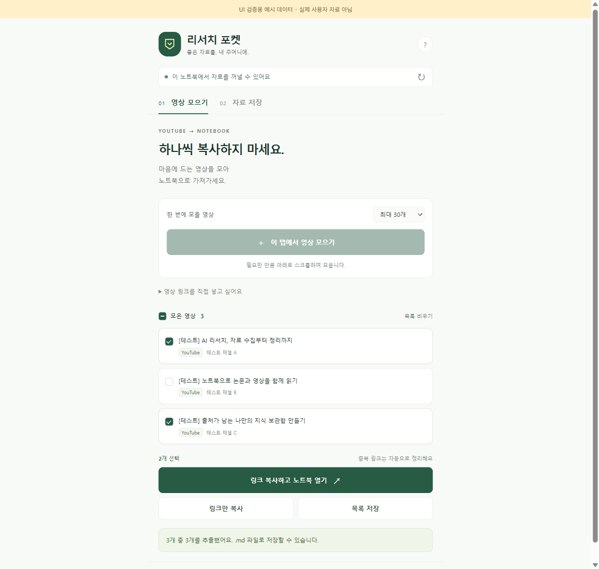
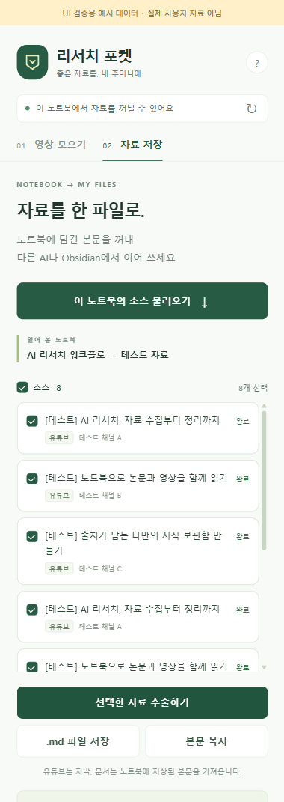

[English](README.en.md) | 한국어

# 리서치 포켓

**유튜브 영상은 한 번에 모으고, 노트북 자료는 한 파일로 꺼내는 브라우저 옆 패널.**

유튜브 영상을 NotebookLM(Gemini 노트북)의 소스로 넣으려면 링크를 하나씩 복사해 붙여 넣어야 합니다. 노트북에 쌓인 소스 본문을 다른 AI 채팅이나 Obsidian으로 옮기려 해도 한 파일로 내보낼 방법이 마땅치 않습니다. 리서치 포켓은 이 두 가지 일을 Chrome·Edge 옆 패널 하나에서 처리합니다.

API 키도, 별도 서버도, 따로 설치할 프로그램도 필요 없습니다. 확장 프로그램 폴더 하나만 불러오면 바로 쓸 수 있습니다.

## 기능

### 영상 모으기

- 유튜브 검색 결과, 채널의 동영상 탭, 재생목록, 일반 영상 페이지에서 영상을 모읍니다. 목록 페이지는 자동으로 스크롤하며 모으고, 쇼츠는 제외합니다.
- 모은 영상 중 필요한 것만 골라 **링크 복사하고 노트북 열기**를 누르면 링크가 복사되고 노트북이 열립니다.
- 영상 링크를 직접 붙여 넣어 목록에 추가할 수도 있습니다.
- 모은 영상은 제목·채널·URL로 검색할 수 있습니다.
- 선택한 영상을 삭제할 수 있고, 삭제는 5분 안에 되돌릴 수 있습니다.
- 패널을 여러 개 열어도 같은 목록을 함께 씁니다. 한 패널에서 추가·선택·삭제한 내용이 다른 패널에도 반영됩니다.
- 목록은 최대 500개까지 보관합니다.

### 자료 저장

- 현재 창에 열린 노트북 중 하나를 고르고 소스를 불러옵니다.
- 선택한 소스의 본문을 추출해 `.md` 파일로 저장하거나 본문을 복사합니다.
- 일부만 추출됐다면 실패했거나 끝나지 않은 소스만 다시 시도할 수 있습니다.
- 본문을 새로 받다가 실패해도 이전에 받은 본문은 그대로 남고, 이전 본문이라는 사실과 추출 시각을 화면과 파일에 표시합니다.
- 가져오지 못한 항목은 누락 목록으로 따로 알려 줍니다. 본문이 하나도 없어도 누락 보고서는 저장할 수 있습니다.
- 요청이 많아 제한에 걸리면 남은 추출을 멈추고, 언제 다시 시도할 수 있는지 안내합니다.

## 화면

| 영상 모으기 | 자료 저장 |
| --- | --- |
|  |  |
| 예시 데이터 화면 | 예시 데이터 화면 (1.0 화면이라 일부 버튼 이름이 1.1과 다릅니다) |

## 설치

리서치 포켓은 Chrome 웹 스토어에 없습니다. 개발자 모드에서 직접 설치해야 하며, **자동으로 업데이트되지 않습니다.**

**요구 사항**: 데스크톱 Chrome 116 이상 또는 Chromium 기반 Edge

### 릴리스 파일로 설치 (권장)

1. [Releases](https://github.com/Hanriverflow/notebookLM-research-helper/releases/latest)에서 `research-pocket-1.1.0.zip`을 받아 압축을 풉니다.
2. 주소창에 `chrome://extensions`를 입력합니다. Edge는 `edge://extensions`입니다.
3. **개발자 모드**를 켭니다.
4. **압축해제된 확장 프로그램 로드**를 누릅니다.
5. 압축을 푼 폴더 안의 **`research-pocket/extension`** 폴더를 선택합니다. `manifest.json`이 들어 있는 폴더입니다.
6. 주소창 옆 퍼즐 아이콘을 눌러 리서치 포켓을 고정합니다. 이제 아이콘을 누르면 옆 패널이 열립니다.

### git으로 설치

```powershell
git clone https://github.com/Hanriverflow/notebookLM-research-helper.git
```

위 2~4단계를 똑같이 진행하고, 5단계에서 저장소의 `extension` 폴더를 선택합니다.

### 업데이트

새 버전은 [Releases](https://github.com/Hanriverflow/notebookLM-research-helper/releases/latest) 페이지에서 확인하세요. 릴리스 파일로 설치했다면 폴더를 새 버전으로 바꾸고, git으로 설치했다면 `git pull`을 실행합니다. 그다음 `chrome://extensions`에서 확장 프로그램 카드의 새로고침(↻) 버튼을 누릅니다.

폴더를 지우거나 옮기면 확장 프로그램도 사라지니 고정된 위치에 두세요.

## 사용법

### 1. 유튜브 영상을 노트북에 넣기

1. 유튜브에서 검색하거나 채널의 동영상 탭, 재생목록을 엽니다.
2. 리서치 포켓 아이콘을 눌러 패널을 열고, **01 영상 모으기**에서 **이 탭에서 영상 모으기**를 누릅니다.
3. 원하는 영상을 선택하고 **링크 복사하고 노트북 열기**를 누릅니다.
4. 노트북에서 **소스 추가 → 웹사이트**를 열고 `Ctrl+V`로 붙여 넣습니다.

### 2. 노트북 자료를 파일로 저장하기

1. 소스 가져오기가 끝난 노트북을 엽니다.
2. 패널의 **02 자료 저장**에서 현재 창의 노트북을 선택하고 **선택한 노트북의 소스 불러오기**를 누릅니다.
3. 필요한 소스를 선택하고 **선택한 자료 최신 본문 추출**을 누릅니다. 일부가 빠졌다면 **실패·미완료 자료 재시도**를 누릅니다.
4. **.md 파일 저장**으로 내려받습니다. 파일 대신 **본문 복사**를 써도 됩니다.

노트북 본문은 패널을 닫으면 사라지니, 추출이 끝나면 먼저 파일로 저장하세요.

## 개인정보와 권한

| 권한 | 용도 |
| --- | --- |
| `sidePanel` | 브라우저 옆 패널 표시 |
| `scripting` | 사용자가 누른 작업을 유튜브·노트북 탭에서 실행 |
| `storage` | 영상 목록과 선택 상태를 브라우저 로컬 저장소에 보관 |
| `clipboardWrite` | 선택한 링크나 본문을 클립보드에 복사 |

| 접근하는 사이트 | 용도 |
| --- | --- |
| `www.youtube.com` | 영상 목록 수집 |
| `notebook.google.com` | 노트북 소스와 본문 읽기 |
| `notebooklm.google.com` | 노트북 소스와 본문 읽기 |

- 외부 분석 서버, 추적, 원격 스크립트가 없습니다.
- 노트북 본문 요청은 사용자가 열어 둔 Google 노트북 페이지 안에서, 그 페이지의 로그인 상태로만 보냅니다. 로그인 정보를 확장 프로그램 저장소로 가져오지 않습니다.
- 확장 프로그램이 직접 보내는 네트워크 요청은 노트북 페이지와 같은 주소의 `batchexecute` 엔드포인트 한 종류뿐입니다.
- 영상 목록은 이 브라우저의 로컬 저장소에만 보관합니다. 노트북 본문은 패널 메모리에만 있고, 패널을 닫으면 사라집니다.
- 노트북에 자료를 자동으로 추가하거나 기존 자료를 수정·삭제하지 않습니다. 소스 추가는 사용자가 노트북 화면에서 직접 합니다.

## 주의사항

- Google의 공식 도구가 아니며 Google과 관련이 없는 비공식 확장 프로그램입니다.
- 노트북 본문 추출은 Google의 비공개 내부 요청을 사용합니다. Google이 서비스를 바꾸면 동작하지 않을 수 있습니다.
- 유튜브 영상은 자막이 있어야 본문을 얻을 수 있습니다. 영상·이미지·PDF 원본은 내려받지 않습니다.
- 자동 스크롤은 최대 45회까지만 하며, 페이지가 실제로 불러온 만큼만 모읍니다. 목표한 개수보다 적게 모일 수 있습니다.
- 1.1.0은 자동 테스트로만 검증했고, 실제 브라우저 사용 환경에서는 다르게 동작할 수 있습니다. 문제가 있으면 알려 주세요. 검증 범위는 [VALIDATION.md](VALIDATION.md)에 정리해 두었습니다.

## 문의

버그 제보나 제안은 GitHub [Issues](https://github.com/Hanriverflow/notebookLM-research-helper/issues)에 남겨 주세요. 개인 프로젝트라 답변이 늦을 수 있습니다.

## 개발

Node.js 20 이상이 필요하며, 런타임과 테스트 모두 외부 의존성이 없습니다.

```powershell
npm test          # 동작 테스트
npm run check     # 확장 파일 검사
npm run preview   # 미리보기 (http://127.0.0.1:4318)
python tools/build-package.py   # 배포 ZIP 생성
```

검증 기록은 [VALIDATION.md](VALIDATION.md)에 있습니다.

## 출처와 라이선스

오빠두엑셀의 [Gemini 노트북과 AI로 리서치 자료 정리하기](https://www.oppadu.com/notes/ypyp4efa22/)에 소개된 두 북마클릿의 흐름을 참고해 새로 구현했습니다. 좋은 아이디어를 공유해 주신 데 감사드립니다.

[MIT 라이선스](LICENSE)로 배포합니다.
